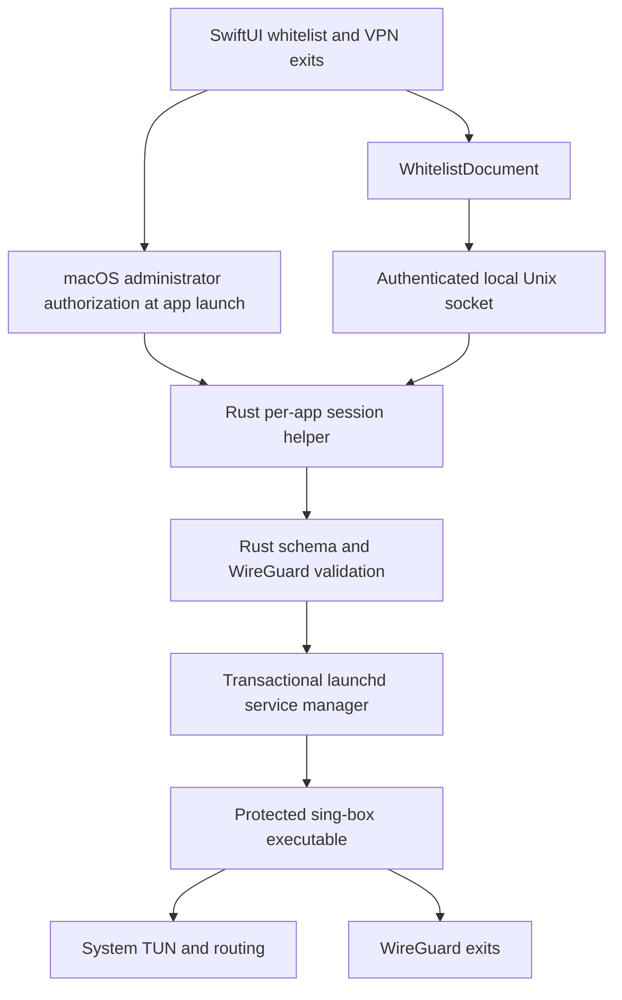

# Architecture

RouteBar separates editable user settings, privileged service management and packet processing.

## Current app path

`WhitelistModels.swift` is the single editable configuration model. It preserves ordered rules, enabled states, VPN exits and DNS settings. Disabled rules are omitted from the engine configuration. Imported YAML/JSON is converted into that model; the app does not maintain separate basic and advanced rule sources.

The app stores its document in UserDefaults. Newly imported WireGuard profiles go to the login Keychain. Imports from an existing configuration can retain external profile references. The app reads those files with normal user permissions and sends profile contents to the privileged helper.

`controller/src/config.rs` validates the routing schema, while `wireguard.rs` validates profiles. `engine.rs` produces the pinned sing-box configuration, including ordered routing, DNS handling and address-family guards. sing-box performs the system TUN, traffic attribution and WireGuard transport.

## App authorization session

On launch, `SessionAuthorization.swift` invokes only the bundled controller's `session-start` command through the macOS administrator dialog. Other privileged actions use direct Unix socket requests; they do not invoke another administrator dialog.

The root helper snapshots the controller and engine under `/private/var/db/routebar-s-UID-ID/`. All ancestors must be root-owned and not group/world writable. The session directory is `0711`, its private directory is `0700`, and the socket is `0600` owned by the app's user.

Requests are bound to the app's UID, exact PID and process start time. The app checks the server's root identity before transmitting configuration. Commands are limited to ping, status, up, reload, down, logs and close; the protocol does not accept arbitrary shell commands, engine paths or raw sing-box configuration.

An initial ping must complete within 15 seconds. Requests and responses are bounded, and profile contents are staged as root-only temporary files. Closing the session or losing the owner process removes the helper and its temporary state after any in-flight transaction completes. An app crash is detected through owner-process checks; forcibly killing the helper or power loss can leave stale files, which are not reusable authorization sessions.

## Background VPN service

The VPN service is separate from the app session:

| Item | Location or identifier |
| --- | --- |
| launchd label | `local.routebar.v2` |
| launchd plist | `/Library/LaunchDaemons/local.routebar.v2.plist` |
| Runtime directory | `/Library/Application Support/RouteBarV2` |
| Runtime access | root-owned `0700` directory; configuration/logs `0600` |

The manager uses an operation lock, validates a candidate before stopping the old service, and copies executables into protected storage. Failed replacement startup triggers an attempt to restore the previous configuration, executable and service. Reload is disruptive to active connections.

Closing the app does not stop this service. Disconnect unregisters the service and removes generated private-key configuration. Imported profiles remain available for future connections.

## Original components

`core/` retains the original Rust WireGuard stack, C ABI, profile validation and diagnostic tools. Shared Swift validation still uses parts of this library. The original Packet Tunnel and Transparent Proxy sources remain in the repository but are not bundled by the current build script. Their separate requirements are described in [legacy notes](LEGACY_NETWORK_EXTENSION.md).
